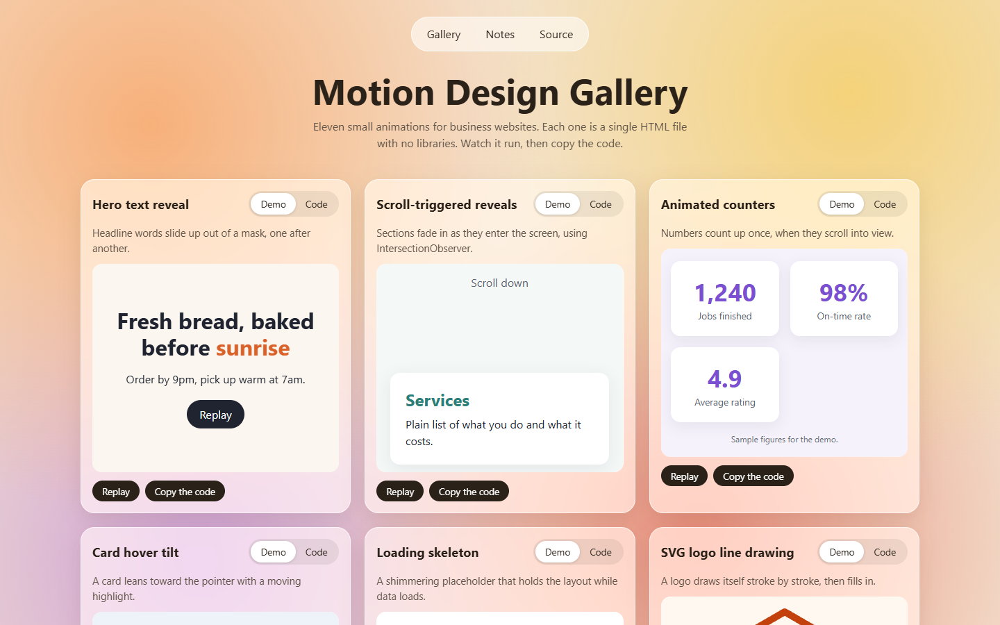
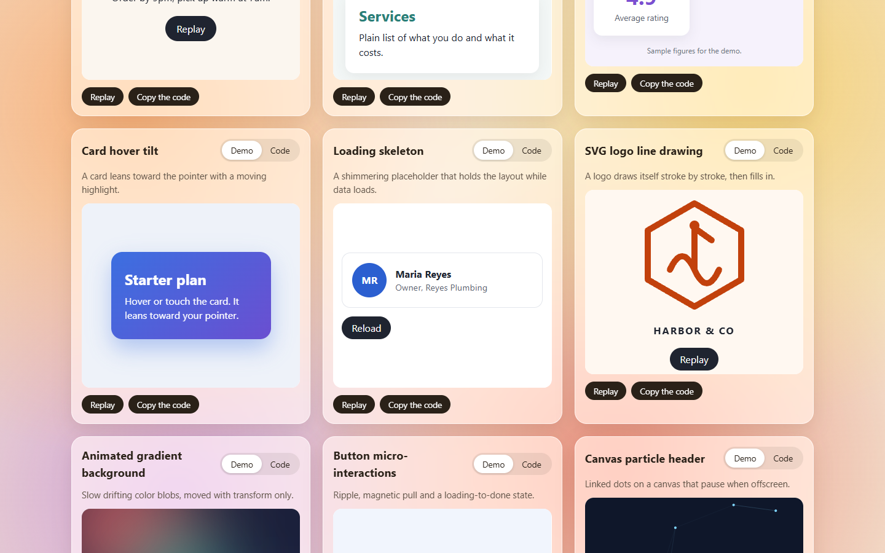

# Motion Design Gallery

[](https://github.com/chasebuilds/motion-design-gallery/actions/workflows/ci.yml)

Eleven web animations for business sites, written in plain HTML, CSS and JavaScript. No frameworks, no build step. Each piece is one file you can paste into a page.

**Live demo: https://chasebuilds.github.io/motion-design-gallery/**



Every card has a live demo, a Code tab with the exact file that is running, and a Copy button.



## The pieces

| Piece | What it does |
|---|---|
| Hero text reveal | Headline words slide up out of a mask in sequence |
| Scroll-triggered reveals | Sections fade in on entry, using IntersectionObserver |
| Animated counters | Numbers count up once when scrolled into view |
| Card hover tilt | Card leans toward the pointer with a moving highlight |
| Loading skeleton | Shimmer placeholder that holds the layout while data loads |
| SVG logo line drawing | Logo draws itself stroke by stroke, then fills |
| Animated gradient background | Drifting blurred shapes, moved with transform only |
| Button micro-interactions | Ripple, magnetic pull, loading-to-done state |
| Canvas particle header | Linked dots; pauses offscreen and when the tab is hidden |
| Page transition | View Transitions API with a CSS fallback |
| Sliding tab indicator | Keyboard-accessible tabs with a gliding bar |

## Use a piece

Open the gallery, press **Copy the code** on a card, and paste it into an `.html` file. Or copy a file from [`pieces/`](pieces). Each one is a full page; for your own site, lift the `<style>` and `<script>` blocks and the markup between them.

## Run it locally

```sh
npm install
npm run serve      # then open the address it prints
```

The gallery fetches the piece files, so it needs to be served over http. Opening `index.html` straight from disk will not work.

## Quality checks

```sh
npm run lint   # ESLint, Stylelint (CSS inside the pieces too), html-validate
npm test       # opens the gallery in a real browser, checks all 11 demos load without errors
```

CI runs both on every push, and the site deploys to GitHub Pages from `main`.

Measured on the author's PC (Edge, 240 Hz display): the particle header averaged 239 frames per second with a worst frame of 8.3 ms, from `npm test`. That is a best case on fast hardware, not a promise for every phone.

## How each piece stays smooth and accessible

- Animations use `transform` and `opacity`, which browsers can run without re-laying out the page.
- The two JavaScript-driven animations (counters, particles) use `requestAnimationFrame`. The particle canvas stops when it leaves the screen.
- Every piece handles `prefers-reduced-motion: reduce` by showing the final state with no movement.
- Tabs follow the ARIA tab pattern, including arrow keys. Headlines keep an `aria-label` so screen readers read them whole.

## Limitations

- Demos run inside sandboxed frames, so they cannot touch the gallery page. A real site has to check for interference from its own CSS.
- The page transition uses the View Transitions API. Browsers without it get a simple fade-in instead of a slide.
- The particle header draws every pair of dots each frame. It is capped at 70 dots, which is fine for a header but would not scale to thousands.
- Frame rate was measured on one desktop PC only. Phones and older laptops were not tested.
- Copy-to-clipboard needs a secure context (https or localhost). Otherwise use the Code tab.
- Sample text, names and numbers in the demos are made up.

## License

MIT, see [LICENSE](LICENSE). Made by Chase Builds.
